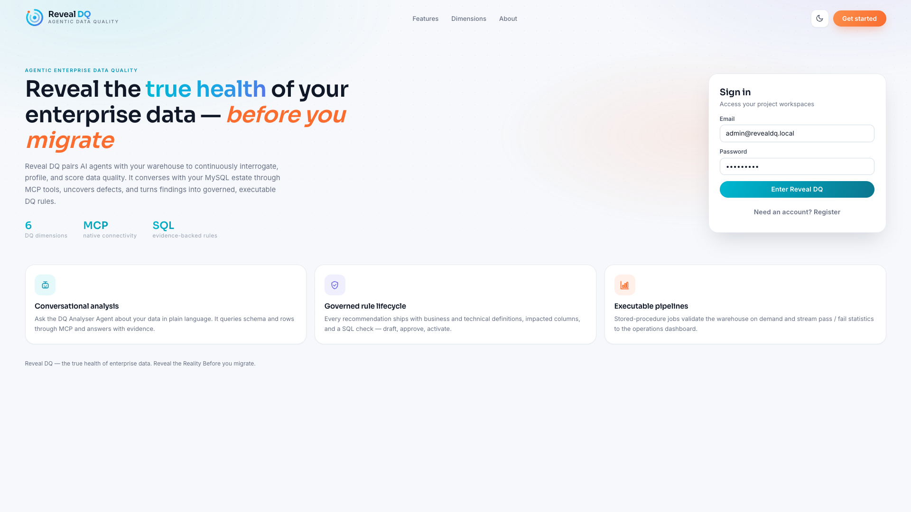

# Reality Reveal

**Reveal the reality behind your enterprise — one product at a time.**

Reality Reveal is a multi-product, agentic enterprise platform. You sign in once, then create
customer-scoped **projects** for the product module you need. Each module ships its own AI agents,
governed artefacts and navigation; the platform provides identity, projects, data-source
configuration, role × screen access control and audit.

**Authored by Harish Kumar.** Built with assistance from AI models in Cursor.



> **UI walkthrough with screenshots:** see [docs/PRODUCT_GUIDE.md](docs/PRODUCT_GUIDE.md).
> **Automation vs AI map:** open [docs/architecture-automation-vs-ai.html](docs/architecture-automation-vs-ai.html) in a browser.

## Product modules

| Code | Product | Status | What it reveals |
|------|---------|--------|-----------------|
| `DQ` | **Reveal DQ** | Live | The true health of enterprise data before you migrate — DQ Analyser Agent (Claude + MCP), DQ Rules Engine, ETL Analyser, ETL Code Conversion Agent, stored-procedure DQ pipelines, operations dashboard. |
| `VOC` | **Reveal VoC** | Preview | Voice of Customer from LinkedIn — register companies, automated extraction of posts/comments that tag or hashtag them into `VOC_DB`, agentic sentiment (happy / negative / neutral / broadcast), categories, themes, de-duplicated actions, scheduled refresh and a VoC Analyser Agent. |

A project belongs to exactly one module (`workspaces.product_code`). The catalog lives in
`product_modules` and is served by `GET /api/v1/products`. Adding a module = one catalog row,
one entry in `frontend/src/app/core/products.ts`, and a `pages/<module>/` folder.

### Reveal VoC — how it works

```
Companies (handle + hashtags) + scrape window (default: last 5 days)
        │
        ▼  AUTOMATION (Go, backend/internal/voc) — no LLM involved
  Provider.Fetch(from, to) ──► voc_posts (raw, structured, VOC_DB)
   ├─ PLAYWRIGHT     default — headless Chromium over LinkedIn's PUBLIC pages, no credentials
   │                 (agents/linkedin_scraper.py, POST /tools/linkedin/scrape)
   ├─ GENERIC_JSON   any HTTP endpoint returning normalised items ({since}/{until} placeholders)
   ├─ IMPORT         JSON upload from the UI
   ├─ SAMPLE         deterministic generator for demos
   └─ OFFICIAL_API   legacy: LinkedIn Community Management API via OAuth (kept, not offered in the UI)
        │
        ▼  AGENTIC (Python, agents/voc_analysis.py)
  POST /voc/analyze ──► voc_post_analysis  (sentiment, score, category, themes, urgency, suggested action)
  POST /voc/actions ──► voc_actions        (grouped, prioritised, de-duplicated)
  POST /voc/ask     ──► VoC Analyser Agent (conversational, evidence-backed)
        │
        ▼
  Scheduler (voc_schedules) repeats the loop incrementally on the chosen cadence.
```

**LinkedIn extraction is a credential-less Playwright scrape of public pages.** The first scrape
in a project auto-creates the `PLAYWRIGHT` source; nothing to configure. For each company and
window `[from, to]` the scraper visits:

1. `linkedin.com/company/{handle}` — the ~10 latest posts/reposts by the organisation. The
   `data-activity-urn` on each card encodes the publish time (top 41 bits = epoch ms), so dating
   is exact and out-of-window posts are dropped without another request.
2. `linkedin.com/feed/update/urn:li:activity:{id}` — each post page carries a schema.org JSON-LD
   block (`SocialMediaPosting` / `VideoObject` / `ImageObject`) with body, author, date, like and
   comment counts and the visible comments (text, author, date). Comments are the customer voice;
   only those inside the window are kept, with their parent post retained for context.
3. Third-party posts naming the company or its hashtags, discovered through a web search index
   (`site:linkedin.com/posts "<company>"`), date-filtered by activity id before loading. This
   leg is best-effort: indexes lag LinkedIn by days to weeks and rate-limit quickly.

Not reachable without a session: `/company/{handle}/posts`, LinkedIn search, hashtag feeds and
deep comment threads. Runs are throttled (1–3 s between pages, ≤25 post pages by default) and
stop cleanly at LinkedIn's sign-in wall, reporting how far they got in the run message. Note that
automated access to LinkedIn is restricted by its User Agreement — this is a pilot tool; keep
volumes small.

Chromium is installed into `.tools/playwright` by `scripts/run-agent.sh` on first start
(`python -m playwright install chromium`).

Pick the window in the UI (Companies → *Scrape window*: last 5/7/14/30 days or any two dates) or
via the API: `POST /workspaces/{id}/voc/sync {"companyId":0,"from":"2026-09-12","to":"2026-09-17"}`.
Scheduled refreshes run incrementally from the last sync (48 h overlap).

## Stack

| Layer | Technology |
|-------|------------|
| UI | Angular 19 (module-driven shell) |
| API | Go (Chi) |
| Agents | Python FastAPI + Claude (Reveal DQ agents today) |
| Warehouse sample | MySQL `RevealDQ` (telco CRM/billing) |
| Platform metadata | MySQL `RevealDQ_ctrl` (users, projects, product modules, ACL, rules, runs, audit) |
| Jobs | MySQL stored procedures |
| IDE DB tools | MySQL MCP (`mcp/`) |

> The MySQL schema names (`RevealDQ`, `RevealDQ_ctrl`) are unchanged from the original
> Reveal DQ MVP so existing data keeps working. They are platform-internal and not user-visible.

## Prerequisites

- Local MySQL with schema `RevealDQ` tables already created
- Fill `.env` from [`.env.example`](.env.example) (`MYSQL_PASSWORD`, optional `ANTHROPIC_API_KEY`)

Optional local toolchains are vendored under `.tools/` (Go, Node) if not installed system-wide.

## First-time setup

```bash
cp .env.example .env
# edit MYSQL_PASSWORD (and ANTHROPIC_API_KEY when ready)

chmod +x scripts/*.sh
./scripts/apply-sql.sh

# start API once so admin user is created, then optionally:
# /usr/local/mysql/bin/mysql -u root -p < sql/ctrl/003_demo_workspace.sql
```

The API self-heals the control-plane schema on every start (`backend/internal/db/schema.go`):
missing tables are created, the `product_modules` catalog is seeded, and pre-platform
workspaces are tagged as Reveal DQ projects.

Default login after API start:

- Email: `admin@revealdq.local`
- Password: `Admin@123` (override with `ADMIN_PASSWORD`)

## Run (three terminals)

```bash
./scripts/run-api.sh      # :8080  Reality Reveal API
./scripts/run-agent.sh    # :8090  Reveal DQ agents
./scripts/run-ui.sh       # :4200  Reality Reveal UI
```

Open http://127.0.0.1:4200 → sign in → **New project** → pick **Reveal DQ** or **Reveal VoC** →
create. A DQ project lands on the DQ Analyser Agent; a VoC project lands on the VoC overview.

## Workspace boundary

Cursor Rule + Skill under `.cursor/` enforce: you can’t delete or add files outside of `/Users/vedantsubramanian/Documents/Harish/AgenticAI_Projects/AgenticDataGov`.

## Project layout

```
frontend/   Angular app — core/products.ts is the product-module registry
  src/app/pages/login          Reality Reveal landing + sign-in
  src/app/pages/workspaces     Projects home (module picker, filters)
  src/app/pages/workspace-shell Module-driven project shell
  src/app/pages/{analyser,rules,etl,conversion,dashboard,pipelines}  Reveal DQ
  src/app/pages/voc            Reveal VoC
  src/app/pages/{config,settings}  Shared across modules
backend/    Go API — /products, /workspaces (product-aware), Reveal DQ endpoints
agents/     Python Reveal DQ agents (analyser, ETL, conversion) + MCP MySQL server
sql/        RevealDQ_ctrl schema (+ 005_product_modules.sql), RevealDQ seed, DQ procs
mcp/        MySQL MCP config
scripts/    apply-sql / run-* helpers
docs/       Product guide, architecture map, UI screenshots
```

## Documentation

| Doc | Contents |
|-----|----------|
| [docs/PRODUCT_GUIDE.md](docs/PRODUCT_GUIDE.md) | Screen-by-screen UI guide with screenshots |
| [docs/architecture-automation-vs-ai.html](docs/architecture-automation-vs-ai.html) | Which parts are automation vs AI / agents, with flow diagrams |
| [README.md](README.md) | Setup and run instructions |
