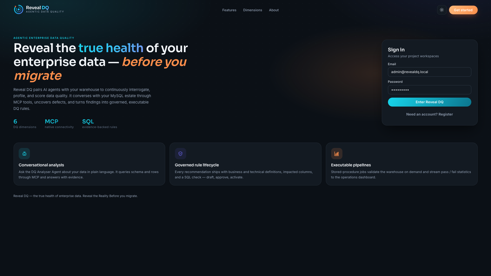
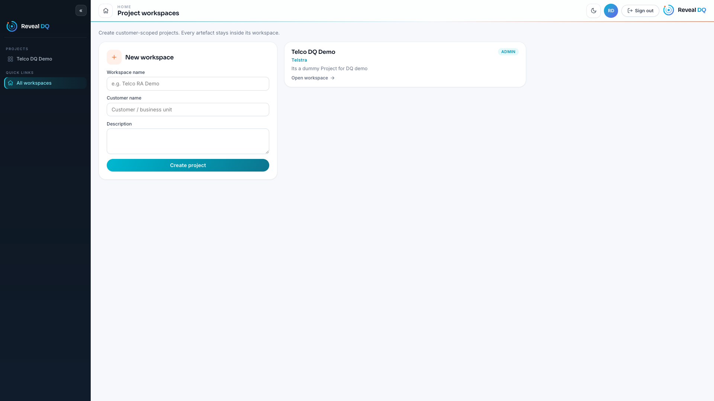
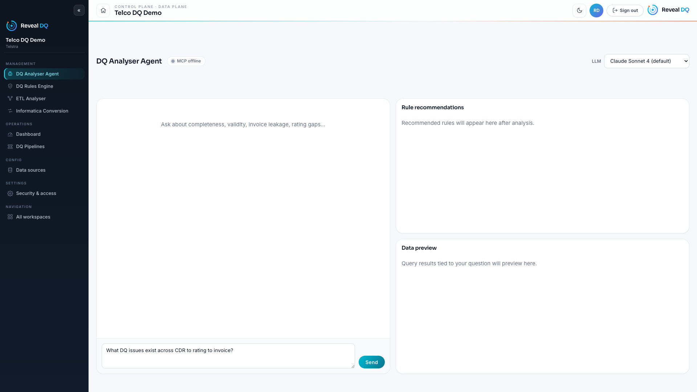
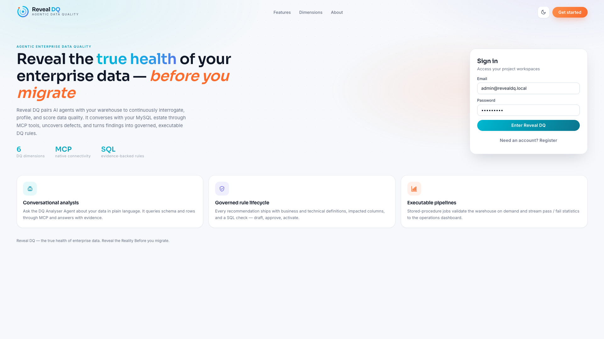

# Reveal DQ — Product Guide

**Authored by Harish Kumar.** Built with assistance from AI models in Cursor.

**the true health of enterprise data. Reveal the Reality Before you migrate.**

This guide walks through each screen in the Reveal DQ MVP: what it is for, what you can do on it, and how the pieces fit together.

---

## Platform at a glance

Reveal DQ is an enterprise data-quality platform. You create **customer-scoped project workspaces**, connect a **MySQL** warehouse, chat with a **DQ Analyser Agent** (Claude + MCP), turn findings into **governed DQ rules**, run those rules as **stored-procedure pipelines**, and watch outcomes on an **operations dashboard**.

| Layer | Technology |
|-------|------------|
| UI | Angular |
| API | Go (Chi) |
| Agent | Python FastAPI + Claude |
| Warehouse (sample) | MySQL `RevealDQ` |
| Platform metadata | MySQL `RevealDQ_ctrl` |
| Jobs | MySQL stored procedures |
| IDE DB tools | MySQL MCP (`mcp/`) |

---

## 1. Landing & sign-in

**Purpose:** Introduce the product and authenticate users.

**What you see**
- Product name, logo, and short definition of Reveal DQ
- Highlights for the six DQ dimensions, MCP connectivity, and SQL-backed rules
- Capability cards: conversational analysis, ruled lifecycle, executable pipelines
- Sign-in / register form on the right
- Theme toggle (light / dark)

**What you can do**
- Sign in with your account (default admin after first API start: `admin@revealdq.local`)
- Register a new account
- Switch light/dark theme
- If already signed in, continue into workspaces or **Sign out** back to this page

---

## 2. Project workspaces (Home)

**Purpose:** Create and open customer-scoped projects. Every artefact (connections, rules, pipelines, runs) stays inside its workspace.

**What you see**
- Collapsible dark **explorer** ribbon listing your projects
- Top banner with home, theme toggle, user avatar, and a visible **Sign out** button
- Form to create a new workspace (name, customer, description)
- Cards for existing workspaces with role badge (e.g. ADMIN)

**What you can do**
- Create a new project workspace
- Open a workspace into the Control / Data Plane shell
- Sign out to return to the landing page

---

## 3. Workspace shell (Control Plane · Data Plane)

Once you open a workspace, the left ribbon becomes the full product navigation:

| Section | Screens |
|---------|---------|
| **Management** | DQ Analyser Agent, DQ Rules Engine, ETL Analyser (stub), Informatica Conversion (stub) |
| **Operations** | Dashboard, DQ Pipelines |
| **Config** | Data sources (MySQL) |
| **Settings** | Security & access control |

The banner always shows the workspace name, home link, theme toggle, avatar, **Sign out**, and the Reveal DQ logo.

---

## 4. DQ Analyser Agent

**Purpose:** Conversational data-quality analysis against the connected MySQL warehouse via MCP tools and Claude.

**Layout**
- **Left:** Stateful chat (conversation persists when you switch tabs)
- **Top right:** Rule recommendations from the agent
- **Bottom right:** Data preview (query results tied to the question)

**Toolbar**
- **MCP status** (green when connected) — hover for MySQL host / database details
- **LLM picker** — Claude Sonnet (default) or a cheaper Haiku option

**What you can do**
- Ask questions in plain language (completeness, validity, rating gaps, invoice leakage, etc.)
- Review recommended rules with:
  - Business & technical definitions
  - DQ dimension
  - Impacted tables / columns
  - Supporting SQL (monospace code block)
- **Save to Rules Engine** to persist a recommendation as a draft rule

---

## 5. DQ Rules Engine

**Purpose:** Govern the lifecycle of DQ rules produced by the analyser (or seeded later).

**What you can do**
- Browse rules with dimension, status, impact, and SQL check
- Move rules through **DRAFT → APPROVED → ACTIVE** (or retire active ones)
- Active rules are available for pipeline / job execution

---

## 6. Operations — Dashboard

**Purpose:** Summarise DQ execution health for the current workspace.

**What you see**
- Metrics: total runs, passed, failed, errors, draft vs active rules
- Breakdown by DQ dimension (runs / failed)

Use this after running pipelines to see whether checks are cleaning up or still failing.

---

## 7. Operations — DQ Pipelines

**Purpose:** Execute warehouse DQ jobs implemented as MySQL stored procedures.

**What you can do**
- List available pipelines (procedure name + description)
- **Run** a job on demand
- Inspect recent runs (status, rows checked / failed, message)

Sample procedures in this MVP cover completeness, consistency, and validity checks on the telco demo data.

---

## 8. Config — Data sources

**Purpose:** Connect the workspace to MySQL so the analyser and jobs have a target.

**What you can do**
- Add a MySQL connection (host, port, database, credentials)
- List configured connections
- **Test** a connection (table count / connectivity check)

For the MVP, MySQL is the supported source (e.g. local `RevealDQ`).

---

## 9. Settings — Security & access

**Purpose:** Control who can view or edit which screens (role × screen ACL matrix).

**What you can do**
- Toggle **View** / **Edit** per role and screen
- Persist ACL changes for the workspace

---

## 10. Coming soon (stubs)

**ETL Analyser Agent** and **Informatica DQ Conversion Agent** are stub screens reserved for later releases. They appear in Management so navigation and ACL can be wired early.

---

## Sign-out behaviour

**Sign out** is available on every authenticated banner. It clears the session and returns you to the landing page so you can share the product introduction without staying inside a workspace.

---

## Typical first run

1. Apply SQL and start API, agent, and UI (see root [README](../README.md)).
2. Sign in on the landing page.
3. Create or open a workspace.
4. **Config** → add / test MySQL connection.
5. **DQ Analyser Agent** → ask questions → save recommended rules.
6. **DQ Rules Engine** → approve / activate rules.
7. **DQ Pipelines** → run jobs.
8. **Dashboard** → review pass / fail statistics.

---

## Related docs

- [README.md](../README.md) — setup, stack, and how to run locally
- `sql/` — control-plane schema, warehouse seed, and DQ procedures
- `mcp/` — MySQL MCP configuration for IDE / agent tooling
